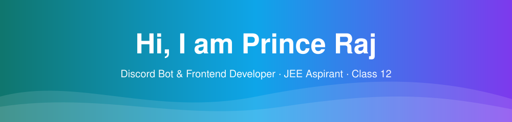

<!-- ============================================================
  FRONTEND DEVELOPER GITHUB PROFILE README
  Find & replace these placeholders before publishing:
    princetsx  -> your GitHub username
    (Name, location and JEE details are already filled in for Prince Raj)
    YOUR_LINKEDIN_URL / YOUR_EMAIL / YOUR_PORTFOLIO_URL
  Remove any section or badge you don't want. Don't claim skills you don't have.
============================================================ -->

<!-- ================= HEADER BANNER ================= -->
<div align="center">
  
</div>

<!-- ================= TYPING ANIMATION ================= -->
<div align="center">
  <a href="https://git.io/typing-svg">
    
  </a>
</div>

<br />

<!-- ================= QUICK BADGES ================= -->
<div align="center">
  
  
  
  
</div>

<br />

<!-- ================= ABOUT ================= -->
## 👨‍💻 About Me

```js
const developer = {
  name: "Prince Raj",
  status: "Class 12 student",
  location: "Bihar Sharif, Nalanda, Bihar, India",
  currentGoal: "Cracking JEE",
  codingInterest: ["Discord Bot Development", "Frontend Development"],
  pastProject: "Kira - a Discord music bot",
  currentlyLearning: ["HTML", "CSS", "JavaScript"],   // TODO: update to what you actually study
  currentlyBuilding: "A Discord utility bot",
  funFact: "TODO: something memorable about you",
  lookingFor: "Learning, mentorship, and beginner-friendly collaborations",
};
```

> 💡 *"Studying hard for JEE by day, building things for the web whenever I can."*

<br />

<!-- ================= TECH STACK ================= -->
## 🛠️ Tech Stack

<!-- TODO: Keep only the icons you actually use. Full icon list: https://skillicons.dev -->

**Core**

<p>
  
</p>

**Frameworks & Libraries**

<p>
  
</p>

**Tooling & Workflow**

<p>
  
</p>

**Discord Bot Development**

<!-- TODO: Add the language/library you use for your bots (e.g. nodejs for discord.js, py for discord.py) to this list. -->
<p>
  
</p>

**Learning / Exploring**

<p>
  
</p>

<br />

<!-- ================= FEATURED PROJECTS ================= -->
## 🚀 Featured Projects

<table>
  <tr>
    <td width="50%" valign="top">
      <h3>🛠️ Utility Bot (In Progress)</h3>
      <p>A Discord utility bot I'm currently building.</p>
      <p>
        
        
      </p>
      <a href="YOUR_REPO_URL">Repository</a> · <a href="YOUR_LIVE_URL">Live Demo</a>
    </td>
    <td width="50%" valign="top">
      <h3>🎵 Kira - Music Bot</h3>
      <p>A Discord music bot I built earlier for playing music in voice channels.</p>
      <p>
        
        
      </p>
      <a href="YOUR_REPO_URL">Repository</a> · <a href="YOUR_LIVE_URL">Live Demo</a>
    </td>
  </tr>
</table>

<br />

<!-- ================= GITHUB STATS ================= -->
## 📊 GitHub Stats

<!-- Replace princetsx. Theme "tokyonight" looks good on both light & dark pages. -->

<div align="center">
  
  
</div>

<div align="center">
  
</div>

<br />

<div align="center">
  
</div>

<br />

<!-- ================= ACTIVITY ================= -->
## ✨ Currently / Recently

<!-- TODO: Optional. Add real achievements, or delete this section. -->

- 🔭 Working on: **A Discord utility bot**
- 🎵 Previously built: **Kira, a Discord music bot**
- 🌱 Learning: **TODO**
- 📝 Latest write-up / blog post: **TODO** ([link](YOUR_BLOG_URL))
- 🏆 Achievement / certification: **TODO**

<br />

<!-- ================= CONNECT ================= -->
## 🤝 Let's Connect

I'm happy to connect with fellow JEE aspirants, developers, and anyone who loves learning and building.

<p>
  <a href="YOUR_LINKEDIN_URL">
    
  </a>
  <a href="mailto:YOUR_EMAIL">
    
  </a>
  <a href="YOUR_PORTFOLIO_URL">
    
  </a>
  <!-- Optional extras: uncomment & edit
  <a href="YOUR_DISCORD_SERVER_OR_PROFILE_URL"></a>
  <a href="YOUR_TWITTER_URL"></a>
  <a href="YOUR_CODEPEN_URL"></a>
  -->
</p>

<!-- ================= FOOTER ================= -->
<div align="center">
  
</div>
